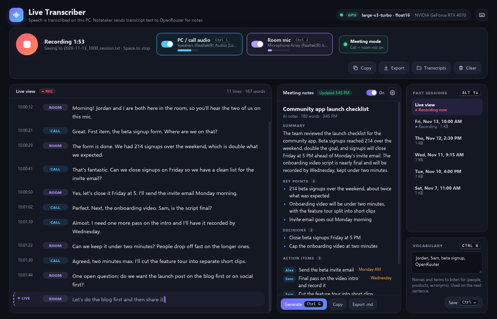
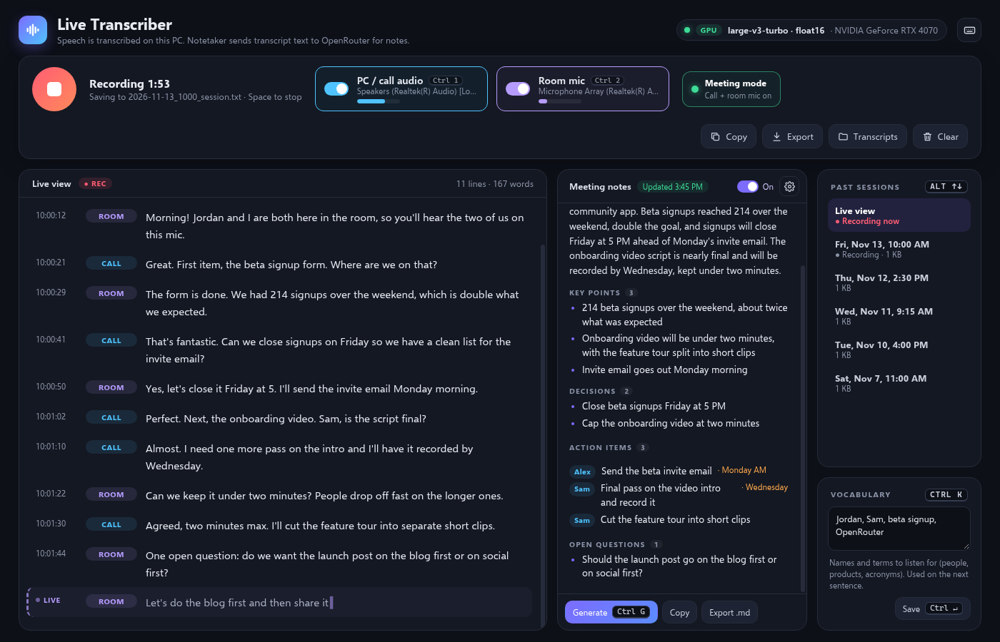
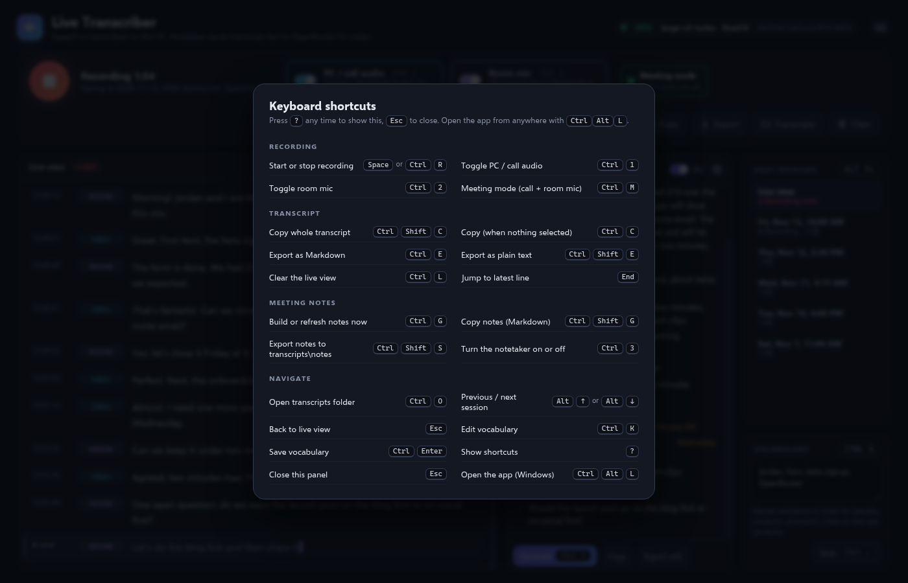

# Live Transcriber

On-device speech-to-text for this PC's audio and microphone, with an optional Meeting Notetaker.

[](https://github.com/asjames18/live-transcriber/releases/latest)


[](LICENSE)

## Overview

Live Transcriber captures PC and call audio (WASAPI loopback) and/or the default room microphone, transcribes speech locally with [faster-whisper](https://github.com/SYSTRAN/faster-whisper), and shows a live transcript in its own Microsoft Edge window (or the system browser if Edge is not available). A private server listens on `127.0.0.1` only (default port `48241`). Speech recognition is English-only.

Transcription uses the GPU when CUDA is available (`large-v3-turbo`, float16) and falls back to the CPU (`small.en`, int8). If a GPU error occurs mid-session, the app switches to the CPU model and keeps recording.

## Key features

- **Live transcription** — Partial results while you speak, then finalized lines, with separate labels for PC / call audio and the room mic.
- **Meeting mode** — Record call audio and the room microphone together (`Ctrl+M`).
- **On-device models** — GPU when available, with an automatic mid-session switch to the CPU model if CUDA fails.
- **Vocabulary** — Optional comma-separated names and terms used as Whisper hotwords on the next sentence.
- **Meeting Notetaker (optional, on by default)** — Builds structured notes (title, summary, key points, decisions, action items and questions) from the transcript. It can call an OpenAI-compatible endpoint (OpenRouter by default) on a timer while you record, and again when you stop. If the model is unavailable, a local outline is used instead. You can also generate, copy or export notes by hand.
- **Session history** — Browse past sessions, copy the transcript, and export Markdown or plain text.
- **Keyboard shortcuts** — Start and stop, source toggles, export, notes and more. Press `?` in the app for the full list. A suggested desktop shortcut is `Ctrl+Alt+L`.

## Screenshots



| AI meeting notes | Keyboard shortcuts |
| --- | --- |
|  |  |

## Download

The installer is the supported way to install Live Transcriber:

- [Latest GitHub release](https://github.com/asjames18/live-transcriber/releases/latest) — `LiveTranscriber-Setup-2.1.0.zip`
- [melanatedintech.com/apps](https://melanatedintech.com/apps)

Current release: **2.1.0**. The zip is 87 KB. The first install also downloads the speech engine and Whisper model (see below). Tested on Windows 11.

## Install

1. Download `LiveTranscriber-Setup-2.1.0.zip` and open it.
2. Double-click `Install-LiveTranscriber.cmd`. If you run it from inside the zip, it unpacks itself first. Extracting the zip first also works.
3. If Windows SmartScreen says "Windows protected your PC", click **More info**, then **Run anyway**. The installer is not code-signed.
4. The installer asks before it downloads anything, then can set up:
   - **Python 3.12 or newer**, if it is missing. It can install Python 3.13.17 for your account from python.org (the download's SHA-256 and signature are checked; no administrator account is required).
   - The **Microsoft Visual C++ 2015–2022** runtime if it is missing (official Microsoft download, signature checked; Windows may ask for administrator approval once).
   - A private virtual environment in `%LOCALAPPDATA%\LiveTranscriber\venv` with the pinned packages from `requirements.txt` (about 85–90 MB to download, a few hundred megabytes on disk).
   - The Whisper `small.en` model (about 465 MB) from Hugging Face into `%LOCALAPPDATA%\LiveTranscriber\models`, with progress and retries.
   - An optional GPU path, offered when an NVIDIA GPU is present: the CUDA libraries in `requirements-gpu.txt` (about 2 GB) plus the `large-v3-turbo` model (1.55 GB). You can decline this and use the CPU model.
5. It adds Desktop and Start menu shortcuts (`Ctrl+Alt+L`) and opens the app. Code goes to `%LOCALAPPDATA%\LiveTranscriber\app`, and your data to `%LOCALAPPDATA%\LiveTranscriber\data`.

ffmpeg is not required; PyAV ships its own decoders. A typical CPU install is about 550–750 MB to download, about 1 GB on disk, and 3–10 minutes on a typical connection. With the GPU option, plan on about 5 GB of disk (keep about 6 GB free). If you are offline or a download fails, the installer stops safely; running it again resumes and skips what is already done.

A longer end-user guide ships in the zip as `README.md` (the same text as [`packaging/README.md`](packaging/README.md) in this repository).

To uninstall, double-click `Uninstall-LiveTranscriber.cmd` or use **Start menu > Uninstall Live Transcriber**. The speech engine and models are removed. Your transcripts are kept unless you choose to delete them. Python stays installed.

## Verify the SHA-256

The SHA-256 of `LiveTranscriber-Setup-2.1.0.zip` is:

```
ed2c4fa04b9a7da3d938548710a8faca038f191a6cd4574268b1a66d1ed60232
```

On Windows, open Command Prompt in the folder that contains the zip and run:

```bat
certutil -hashfile LiveTranscriber-Setup-2.1.0.zip SHA256
```

The hash should match the value above and the `LiveTranscriber-Setup-2.1.0.zip.sha256` file attached to the [release](https://github.com/asjames18/live-transcriber/releases/latest). If it does not match, do not run the installer.

## System requirements

- Windows 10 or 11 (64-bit)
- Python 3.12 or newer (the installer can install 3.13.17 if needed)
- A microphone and/or a loopback audio device
- Microsoft Edge, or another system browser as a fallback
- Internet access for the first install (Python, packages and the Whisper model)
- A current NVIDIA driver (optional), for GPU transcription

## How to use it

1. Wait until the speech model shows as ready.
2. Choose **PC / call audio**, **Room mic**, or **Meeting mode** (both).
3. Press Space (or the record button) to start and stop.
4. Use **Copy** or **Export** for the transcript. **Clear** clears the live view only; the saved file is kept. **Transcripts** opens the output folder.
5. Use the Meeting notes panel to toggle the notetaker, generate notes, copy Markdown or export a notes file.
6. Press `?` for keyboard shortcuts.

Installed copies store transcripts under `%LOCALAPPDATA%\LiveTranscriber\data\transcripts\` and optional meeting notes under `transcripts\notes\`.

## Privacy

Live Transcriber is local-first.

- The server binds to `127.0.0.1` only and rejects requests whose `Host` header is not `127.0.0.1` or `localhost` on the app port.
- Speech is processed locally with faster-whisper. Audio is not uploaded for transcription.
- When the Meeting Notetaker is off, nothing is sent off the PC for notes either.
- When the Meeting Notetaker is on, only transcript **text** is sent to the configured OpenAI-compatible endpoint. Audio is not sent. If the endpoint is unavailable, notes fall back to a local outline with no network call.
- The API key is read from a Windows user environment variable at call time (default name `OPENROUTER_API_KEY`). It is never stored in `settings.json` or logs.
- Transcripts, exported files, notes, the local log (`transcriber.log`), models and the Edge window profile stay on this PC.

## Build from source

From a clone of this repository, with Python 3.12 or newer:

```bat
python -m venv .venv
.venv\Scripts\python.exe -m pip install -r requirements.txt
.venv\Scripts\pythonw.exe transcriber.pyw
```

For GPU transcription, also install the packages in `requirements-gpu.txt` (or the commented NVIDIA packages in `requirements.txt`) and have a working CUDA driver.

Models download into `models/` on first use. After the first download, the app sets `HF_HUB_OFFLINE=1` because models are expected to already be present. For the first download, start the app once with `HF_HUB_OFFLINE` unset.

To build the installer zip:

```bat
python packaging\build_dist.py . dist
```

This writes `dist\LiveTranscriber-Setup-2.1.0.zip` and `dist\LiveTranscriber-Setup-2.1.0.zip.sha256`. The packager refuses to build if packed files contain API keys or personal strings.

Copy `settings.example.json` to `settings.json` if you want a starter config, or let the app create one. Live settings live in `settings.json` (gitignored):

- `vocabulary` — optional names and jargon, comma separated
- `notetaker.enabled` — Meeting Notetaker on or off (default: on)
- `notetaker.interval_sec` — auto-refresh interval while recording (default: 180 seconds)
- `notetaker.base_url` — OpenAI-compatible endpoint (default: `https://openrouter.ai/api/v1`)
- `notetaker.model` — model name (default: `openrouter/free`)
- `notetaker.key_env` — **name** of the environment variable that holds the API key (default: `OPENROUTER_API_KEY`)
- `notetaker.timeout` — request timeout in seconds (default: 60)

Useful environment variables:

| Variable | Purpose |
| --- | --- |
| `TX_PORT` | Server port (default `48241`) |
| `TX_MODEL` | GPU model name (default `large-v3-turbo`) |
| `TX_CPU_MODEL` | CPU fallback model name (default `small.en`) |
| `TX_DEVICE` | Set to `cpu` to skip the GPU and load the CPU model immediately |
| `TX_NO_WINDOW` | Set to `1` to start the server without opening a window |

`test/bench.py` and `test/export_check.py` are optional developer checks.

## Troubleshooting

**SmartScreen blocks the installer.** Click **More info**, then **Run anyway**. The installer is not code-signed.

**The installer says Python is missing.** Let it install Python 3.13.17 for your account, or install Python 3.12+ from [python.org](https://www.python.org/) yourself and run the installer again.

**The first install takes several minutes or fails mid-download.** The Whisper model is about 465 MB, and a typical CPU install is 550–750 MB in total. Stay online; running the installer again resumes and skips what is already done.

**The model never shows as ready.** Confirm the `small.en` model finished downloading into `%LOCALAPPDATA%\LiveTranscriber\models` (or `models/` when running from source). If you are running from source, start once with `HF_HUB_OFFLINE` unset so the model can download.

**No audio is captured.** Check that a microphone and/or loopback device is available, and that Windows is allowing the app to use the microphone.

**GPU transcription is not used.** The GPU option needs a current NVIDIA driver and the optional CUDA packages. You can stay on the CPU model, or set `TX_DEVICE=cpu` to skip the GPU.

**The window does not open.** Confirm Microsoft Edge or another browser is available. If port `48241` is already in use, set `TX_PORT` to a free port.

## License

This project is licensed under the [MIT License](LICENSE). Copyright (c) 2026 Antonio James.

Runtime packages are listed in `requirements.txt` (and optionally `requirements-gpu.txt`): faster-whisper, CTranslate2, PyAV, NumPy, Hugging Face Hub, tokenizers, ONNX Runtime and PyAudioWPatch, plus optional NVIDIA CUDA libraries. Whisper models are downloaded from Hugging Face (`Systran/faster-whisper-small.en` and, for GPU, `mobiuslabsgmbh/faster-whisper-large-v3-turbo`). Those projects are licensed by their authors; see each project for its terms. Optional meeting notes may call an OpenAI-compatible endpoint that you configure (OpenRouter by default). Python itself is licensed under the [PSF License](https://docs.python.org/3/license.html).

## Made by

[Antonio James](https://antoniojames.dev) / [Melanated in Tech](https://melanatedintech.com)

- [antoniojames.dev](https://antoniojames.dev)
- [melanatedintech.com](https://melanatedintech.com)
- [github.com/asjames18](https://github.com/asjames18)
